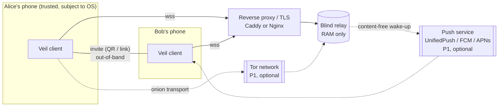
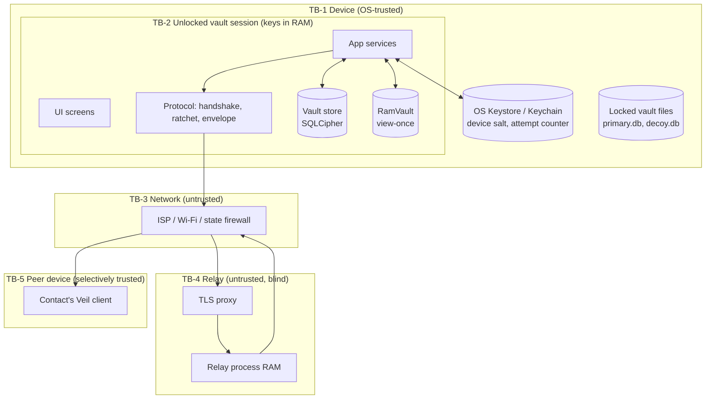
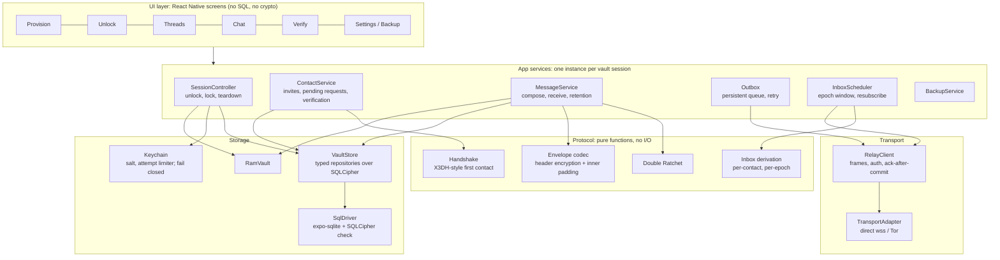
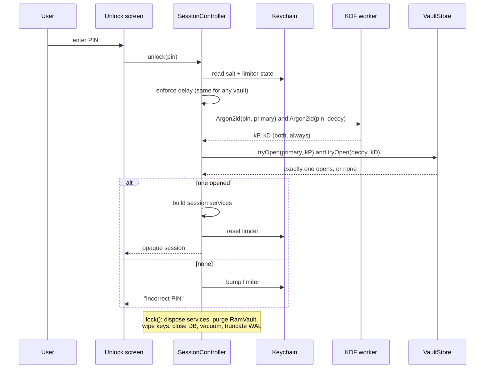
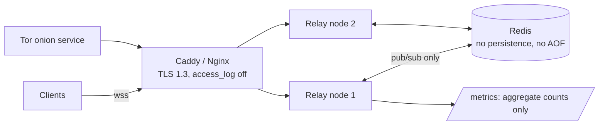

# 03 — Architecture

**Date:** 2026-11-02 · **Depends on:** [00-audit.md](00-audit.md), [01-product-plan.md](01-product-plan.md), [02-features.md](02-features.md) · **Status:** draft for approval · **Supersedes:** `docs/ARCHITECTURE.md` (stale, see audit §3)

This document describes **two states**:

- **Current**: what the code at `2fa1e3e` actually does, with tags [implemented] / [partial] / [planned] / [unknown].
- **Target**: the Phase 1–2 design. Everything marked **(target)** is a proposal, not code. Byte-level formats live in `04-protocol-and-api.md`; key lifecycle and the PIN model live in `05-security-and-auth.md`.

Target choices that are still open decisions are marked **(ADR-needed)** and listed in §9.

---

## 1. System context



There is no account server, directory, push gateway owned by Veil, analytics endpoint or update server. The only network peer is a relay the user chose.

---

## 2. Trust boundaries



| Boundary | What crosses it | Rule |
|---|---|---|
| TB-1 → TB-2 (unlock) | PIN in, vault key out | Both partition keys derived on every attempt; nothing outside TB-2 learns which vault opened |
| TB-2 → TB-1 (lock) | Nothing | **All** TB-2 state is destroyed on lock: keys, ratchet cache, subscriptions, RAM vault (fixes A-10) |
| TB-2 → TB-3 | Fixed-size frames only | Frames carry no identity key, fingerprint, counter, retention or length (fixes A-01, A-02) **(target)** |
| TB-3 ↔ TB-4 | TLS | `wss://` required outside localhost (fixes A-16) **(target)** |
| TB-4 internal | Ciphertext + opaque inbox IDs | Relay stores nothing on disk and logs no IPs or inbox IDs [implemented] |
| TB-5 | Decrypted messages | A peer is trusted to read, not to stay honest. Identity changes are surfaced (F-08) |

---

## 3. Client components

### 3.1 Current layering [implemented / partial]

```
screens/ ─┬─> messaging/MessageService ──> messaging/RatchetManager ──> protocol/ratchet/*
          │            │                          │
          │            ├──> transport/RelayClient ├──> storage/db (saveRatchet/loadRatchet)
          │            └──> transport/EnvelopeCodec (cleartext JSON + padding)
          ├─> protocol/contacts/ContactManager ──> storage/db
          ├─> identity/IdentityManager ──> crypto/keys
          └─> storage/db (screens call getDb() and SQL directly)
```

Problems this creates, all traced in the audit:

- Screens call `getDb()` and run SQL themselves (`ThreadListScreen`, `ChatScreen`), so there is no single place to enforce "nothing branches on vault".
- Lock teardown is split between `App.tsx`, `ThreadListScreen.handleLock` and `db.lockVault`, and misses several components (A-10).
- Module-level singletons (`relayClient`, `messageService`, `ratchetManager`) outlive vault sessions.
- Two ratchet KDF implementations (`crypto/keys.ts` `dhRatchet` and `protocol/ratchet/dhRatchet.ts`) (A-18).

### 3.2 Target layering (target)



Design rules for the target:

1. **One session object per unlock.** `SessionController.unlock()` builds every app service for that vault; `lock()` disposes all of them. No module-level singletons hold vault data. This makes A-10 structurally impossible rather than a checklist.
2. **The protocol layer is pure.** No storage, network or clock access; time and randomness are injected. That makes test vectors (Phase 3) and property tests (Phase 1) straightforward.
3. **UI never sees vault identity.** Screens receive view models only; there is no `partition`, `maskIndex` or `isDecoy` in any view model (fixes A-05).
4. **The single storage gate is `VaultStore`.** Typed repositories (`contacts`, `threads`, `messages`, `ratchets`, `outbox`, `invites`, `relays`) replace raw SQL in screens.
5. **Ack after commit.** `RelayClient` exposes inbound envelopes as a stream; `MessageService` ACKs only after the decrypted message and the new ratchet state commit in one transaction (fixes A-15).

### 3.3 Component responsibilities (target)

| Component | Owns | Must never |
|---|---|---|
| SessionController | Unlock/lock, Argon2id off the JS thread, building and disposing services, attempt limiter | Expose which vault opened |
| ContactService | Invites (create/list/revoke/consume), pending first-contact requests, verification state, key-change detection | Create a contact from an unauthenticated message |
| MessageService | Encrypt/decrypt via ratchet, retention routing, read/TTL arming, receipts | Write view-once to disk; ACK before commit |
| Outbox | Persistent queue, backoff, state transitions queued → sent → delivered | Drop silently; duplicate on retry |
| InboxScheduler | Computing the current inbox set (all contacts × epoch window), hourly resubscribe, catch-up after offline | Use identity keys for inbox auth |
| RelayClient | Socket lifecycle, HELLO/SUB/SEND/ACK, backoff, denied-sub handling | Hold vault keys beyond the session |
| TransportAdapter | Direct `wss://` or Tor SOCKS | Allow `ws://` in release builds except localhost |
| VaultStore | Schema, migrations, sealed fields, vacuum/WAL truncation, ballast | Fall back to unencrypted SQLite |
| Keychain | Device salt, limiter state | Fall back to RAM |
| BackupService | Export/import per vault | Reveal the other vault |

---

## 4. Data flows

### 4.1 Unlock and lock



Current: [partial]. Both keys are derived and both opens attempted [implemented]. Argon2id runs on the JS thread; there is no limiter; teardown is incomplete.

### 4.2 First contact (target; protocol detail in `04`)

```mermaid
sequenceDiagram
  participant B as Bob (inviter)
  participant A as Alice
  participant R as Relay

  B->>B: create invite: IK_B, SPK_B (signed prekey), OPK (one-time), rz, exp, sig
  B-->>A: QR / link (out-of-band)
  A->>A: verify sig + exp; derive rendezvous inbox from rz
  A->>A: X3DH: DH(IK_A,SPK_B), DH(EK_A,IK_B), DH(EK_A,SPK_B), DH(EK_A,OPK)
  A->>R: SEND to rendezvous inbox: sealed {IK_A, EK_A, first ratchet msg}
  B->>R: SUB rendezvous inbox (auth key derived from rz)
  R-->>B: DELIVER
  B->>B: same DHs, decrypt, compute Alice's fingerprint
  B->>B: show pending request; on accept, mark OPK + invite consumed
  Note over A,B: Both now derive per-contact inbox secrets from the session
```

Current: [partial]. The invite holds `ik`, `xk` and `rz`; the first message uses one unauthenticated ephemeral-static DH to the static inbox; `rz` is unused (A-03).

### 4.3 Send and receive (target)

```mermaid
sequenceDiagram
  participant UI as Chat
  participant MS as MessageService
  participant OB as Outbox
  participant RC as RelayClient
  participant R as Relay
  participant RC2 as Peer RelayClient
  participant MS2 as Peer MessageService
  participant VS2 as Peer VaultStore

  UI->>MS: send(text, retention)
  MS->>MS: ratchet encrypt (header in AAD)
  MS->>MS: seal header, pad inside AEAD to fixed size
  MS->>OB: enqueue (persist) + local message row
  OB->>RC: SEND(inbox_e, env)
  RC->>R: SEND
  R-->>RC: ACCEPTED
  RC-->>OB: mark sent
  R-->>RC2: DELIVER(id, env)
  RC2-->>MS2: envelope
  MS2->>MS2: open header, ratchet decrypt (tentative state)
  MS2->>VS2: BEGIN; insert message; save ratchet; COMMIT
  MS2->>RC2: ACK(id)
  MS2-->>OB: (encrypted delivery receipt, optional)
```

Current: [partial]. The envelope is cleartext JSON with an outer pad (A-02), ACK happens before decode (A-15), there is no outbox, and "delivered" means "relay accepted".

### 4.4 Inbox lifecycle (target, ADR-needed)

- **Proposal:** one inbox **per contact, per epoch**, derived from a session secret both sides share. Inbox auth keys are derived from the same secret.
  - Pros: the relay cannot link a user's contacts to each other or across epochs; an invite holder cannot compute or squat inboxes (fixes A-01, A-09).
  - Cost: one SUB per contact per epoch, so the relay sees the subscription *count*. Mitigations: cap by bucketing (pad SUB count to a bucket, e.g. 8/16/32) and batch `SUB` frames.
- **Window:** subscribe to `[e − k, e + 1]`, where `k` covers the relay TTL (24 h → k = 24 at hourly epochs). The alternative is lengthening the epoch to reduce SUB load; the epoch length is a parameter in `04` (fixes A-08).
- InboxScheduler re-computes and re-subscribes at every epoch boundary and on reconnect.

---

## 5. Storage layout

### 5.1 Files on device

| Item | Location | Protection | Current |
|---|---|---|---|
| `veil_vault_primary.db` (+ `-wal`, `-shm`) | App sandbox | SQLCipher (vault key subkey) + field AEAD | [partial]: SQLCipher unverified (A-13) |
| `veil_vault_decoy.db` (+ `-wal`, `-shm`) | App sandbox | Same | Same |
| Device salt (16 B) | Keystore / Keychain, `THIS_DEVICE_ONLY` | OS | [partial]: RAM fallback (A-13) |
| Attempt limiter state | Keystore / Keychain (outside both vaults) | OS | [planned] |
| Relay list for the pre-unlock connection | None. No connection before unlock | — | (target) |
| Backups | User-chosen location only | Passphrase Argon2id + AEAD | [planned] |

Both vaults are excluded from OS backup (F-05 AC 5).

### 5.2 Vault schema (each vault identical)

Existing tables, from `storage/db.ts`: `meta`, `masks`, `contacts`, `threads`, `ratchets`, `messages`, `ballast`.
Target additions are marked +. Columns marked 🔒 are AEAD-sealed at the field level in addition to SQLCipher.

| Table | Key columns | Notes |
|---|---|---|
| `meta` | `canary` 🔒, `master_seed` 🔒, `schema_version` | Canary = only PIN oracle [implemented] |
| `masks` | `mask_index`, `label` 🔒, `fingerprint` 🔒 | Rename the concept to "identity" in UI; no index shown (A-05) |
| `contacts` | `id`, `alias` 🔒, `sign_pk` 🔒, `dh_pk` 🔒, `fingerprint` 🔒, `fp_tag`, `verified_at`, + `verification_state`, + `key_changed_at` | Persist CHANGED_IDENTITY (A-11) |
| `threads` | `id`, `contact_id`, `default_retention`, `last_activity_at`, `unread_count` | — |
| `ratchets` | sealed keys, counters, `skipped_keys` 🔒 | + `inbox_secret` 🔒 for per-contact inboxes |
| `messages` | `id` (local, CSPRNG), + `remote_id`, `body` 🔒, `retention` CHECK ≠ viewOnce, timestamps | AAD gains `thread_id` (A-20); local IDs never come from the wire (A-15) |
| + `outbox` | `id`, `thread_id`, `envelope` 🔒, `state`, `attempts`, `next_attempt_at` | F-10 |
| + `invites` | `id`, `opk_sk` 🔒, `rz` 🔒, `exp`, `state` (open/consumed/revoked) | F-06 one-time and revoke |
| + `pending_contacts` | `id`, `initiator_ik` 🔒, `first_msg` 🔒, `received_at` | F-07 AC 4 |
| + `relays` | `url`, `pinned_key`, `enabled` | Per vault (F-13) |
| `ballast` | random blobs | Rename to a neutral name; rebalance on lock **(ADR-needed)** |

### 5.3 Keys in memory during a session

`vaultKey` → HKDF-style split into `sqlcipherKey` and `fieldKey` (fixes A-13 key reuse) → identity keys (from the sealed seed) → per-thread ratchet states (cache owned by the session) → per-message keys (wiped after use). Exact derivations are in `05`.

---

## 6. Relay architecture

### 6.1 Current [implemented / partial]

Single Node.js process (`server/src/relay.ts`):

- `http` server with `/healthz` plus `ws` WebSocketServer, compression off.
- RAM maps: `queues` (inbox → envelopes, 24 h TTL, depth 256), `claims` (inbox → first-claim key, 2 h), `subscribers`.
- Per-connection token-bucket rate limit (20/s, burst 60).
- `RelayBus` interface with `InMemoryRelayBus` and `RedisRelayBus`. **The bus is never initialised** (A-17).

### 6.2 Target (target)



Changes:
- **Admission control:** global queued-bytes budget; `DROPPED` when full; claim-map cap; SUB inbox-format validation; proof-of-work or token on first SEND to a new inbox **(ADR-needed)** (A-14).
- **Auth:** SUB is signed by a per-inbox key, not an identity key. The relay API is unchanged; only the key the client uses changes (A-01).
- **Bus:** either wire `initBus()` and test against real Redis in CI, or remove multi-node until Phase 5 (A-17). *Recommendation: remove for MVP; single node is enough for 10 testers.*
- **Packaging:** a real Dockerfile, a compose file with Caddy, and documented env vars (F-15).
- **Observability:** a `/metrics` endpoint behind a flag, exposing only connection count, queue depth total, bytes buffered and drops. No inbox IDs, no per-client data.

---

## 7. Deployment topology

| Stage | Topology | Who runs it |
|---|---|---|
| Dev | `npm run server` on localhost `ws://`, Expo dev client | Developer |
| Phase 1 exit | One public relay (single node) on a small VPS behind Caddy, `wss://` | Project |
| Phase 2 testers | Same, plus an optional second relay in another region | Project |
| Phase 5+ | Docker image; organisations self-host; optional onion service; optional multi-node with Redis | Organisations, project |

The client ships with **no hard-coded production relay** in release builds. The relay comes from the invite (inviter's relay) or from settings. This keeps the zero-directory promise and lets each vault use different relays.

---

## 8. Failure modes

| # | Failure | Effect today | Target behaviour | Ref |
|---|---|---|---|---|
| FM-1 | App killed between ACK and DB write | Message lost | ACK after commit; relay redelivers | A-15 |
| FM-2 | Recipient offline > 1 h | Messages never claimed, lost after 24 h | Catch-up window covers relay TTL | A-08 |
| FM-3 | Relay restart | All queued mail lost (RAM only, by design) | Same, by design. Sender's outbox retries anything not end-to-end acknowledged, if receipts are on; otherwise documented | F-10 |
| FM-4 | Relay queue full | Oldest silently evicted | `DROPPED` → sender outbox retries with backoff | A-14 |
| FM-5 | SUB denied (squatter or bug) | Silently ignored | Retry; surface "can't reach inbox" after N tries; per-contact inboxes make squatting impossible without session secret | A-09 |
| FM-6 | Keystore write fails at setup | Salt kept in RAM → vault unopenable after restart | Setup fails with an explanation; nothing provisioned | A-13 |
| FM-7 | SQLCipher not linked | Silent plaintext metadata | Refuse to provision or open | A-13 |
| FM-8 | Argon2id slow on Hermes | UI freeze / ANR [unknown] | Run off the JS thread (native module or worklet); parameters tuned to ≤ 3 s | F-02 |
| FM-9 | Corrupt ratchet row | `loadRatchet` returns null → new session silently created | Mark thread "session broken", offer re-handshake, never auto-replace | — |
| FM-10 | Clock skew between phones | Wrong epoch inbox | Window includes e+1; epoch derived with tolerance; relay time not trusted | — |
| FM-11 | Message over size limit | Throws after local insert; duplicate local copy | Composer blocks; attachments path for large content (P1) | A-15 |
| FM-12 | Lost or seized phone, no backup | Identity gone | Backup/restore (F-14); "identity lost" path tells contacts to re-verify | F-14 |
| FM-13 | Contact re-installs (new keys) | New "Peer XXXX" contact or silent re-key | Pending request flagged as "possible key change of <alias>" | A-11 |
| FM-14 | Both vaults open with one PIN (degenerate) | Fails closed [implemented] | Same | — |

---

## 9. Decisions this document needs (become ADRs)

| ADR | Question | Proposal |
|---|---|---|
| ADR-001 | First-contact handshake | X3DH-style with signed prekey + one-time prekey carried in the invite |
| ADR-002 | Inbox addressing | Per-contact, per-epoch, derived from session secret; SUB count bucketed |
| ADR-003 | Header protection | Encrypt the ratchet header; pad inside AEAD; remove sender/recipient fingerprints from the wire |
| ADR-004 | Epoch length and catch-up window | Hourly epochs, window = relay TTL (24 h). Alternative: 6 h epochs, window 4 |
| ADR-005 | Argon2id execution | Native module (e.g. libsodium / argon2 C) off the JS thread vs pure-JS in a worklet; decide after Phase 1 benchmark |
| ADR-006 | Session object model | Per-unlock `SessionController` owning all services; no vault-holding singletons |
| ADR-007 | Multi-node relay | Remove Redis bus for MVP; reintroduce with real tests in Phase 5 |
| ADR-008 | Relay anti-abuse | Proof-of-work vs anonymous tokens (from `02` open question 5) |
| ADR-009 | Ballast policy | Rebalance both vaults on every lock vs provisioning-only |
| ADR-010 | Web build | Dev preview only, separate entry point, no vault features |

---

## 10. Open questions for you

1. **Inbox addressing (ADR-002):** do you accept the relay seeing a *bucketed* subscription count, as the price of unlinkable per-contact inboxes?
2. **Argon2id (ADR-005):** are you willing to add a native module (needs a dev client or prebuild; not Expo Go)? Expo Go already can't run SQLCipher, so the practical cost may be zero.
3. **Multi-node relay (ADR-007):** OK to delete the Redis bus for now, rather than fix it?
4. **Relay in the invite:** should the invite carry the inviter's relay URL (simplest pairing, but the invite then reveals which relay you use), or should relays be configured separately?
5. **Tor (P1):** embed Tor in the app (bigger APK, harder on iOS), or rely on Orbot as an external SOCKS proxy on Android?
